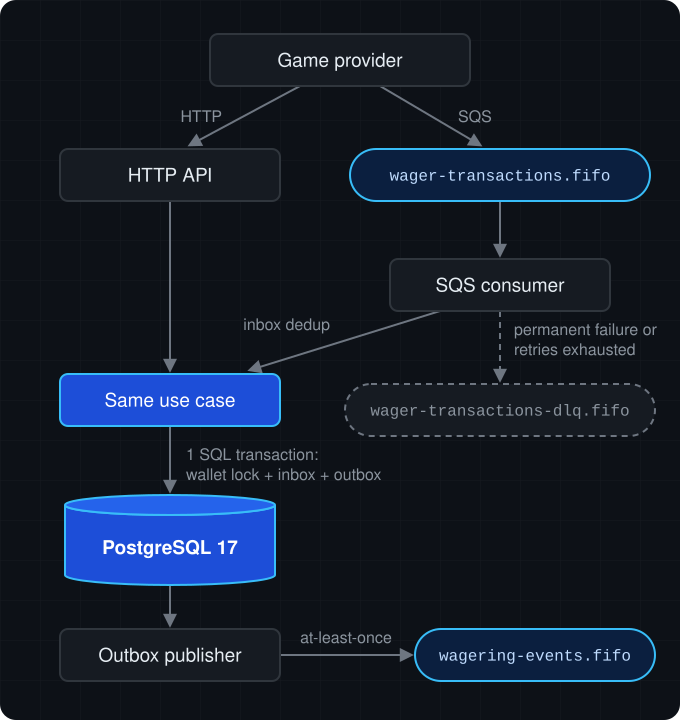

### Full-stack developer focused on backend and development with AI agents

**Looking for an internship or junior role in software development — Alegrete/RS (Brazil) or remote · evening degree program**

[Português](README.md) · **English**

Software Engineering student at **UNIPAMPA — Alegrete/RS, Brazil**, in the 4th of 9 semesters (expected graduation: mid-2029). I like taking an idea off paper and watching it work end to end: gathering the requirements, designing the architecture, building it — and leaving the project organized enough that someone else can step into it the next day.

---

## How I work

I develop with AI agents, under a process I built myself. Every feature starts from an issue with acceptance criteria, is implemented test-first, in small commits, and arrives as a PR reviewed by a reviewer agent. Nothing reaches `main` without my review and my merge.

That process is **ARK**, a kit that started out organizing the team's work on SAGA. The `distributed-wagering-processor`, below, was built with it: 51 PRs.

**3,800+ contributions · 130+ PRs · 360+ issues** in the last 12 months · ARK: **version 10 · 450+ commits · 12 ADRs** (Nov 2026)

  

<a href="https://github.com/PPrauchner/ARK/blob/main/README.en.md"><b>Learn about ARK →</b></a>

---

## Experience

**Extension Research Fellow — AI Horizon Labs / UNIPAMPA** · 2026 – present · 20h/week

Project *Educador 5.0: Training Teachers to Use Artificial Intelligence in Basic Education*. I work on-site in the continuing education of K-12 teachers, translating AI tools into practical classroom use.

---

## Featured projects

### [SAGA — Academic Monitoring and Management System](https://github.com/PPrauchner/SAGA-Sistema-de-Acompanhamento-e-Gestao-Academica)

Management system for graduate programs: student registration, work plans, credit validation, deadline extensions and management reports. Six-person team project, featuring a **logic inference engine built from scratch in Python** and **Aspect-Oriented Programming** for authorization, auditing and alerts.

> **My role:** top contributor to the repository (307 commits). I gathered the requirements, organized the team's work and was responsible for most of the issues and documentation. I **designed the inference engine's architecture** — the split between terms, unification, substitution, resolver and knowledge base — and defined the **declarative rule layer (RL01–RL05)** and the **test suite** the team implemented against. I was **responsible for a large part of the FastAPI backend** — endpoints, business rules and the authorization aspects — and reviewed half of the pull requests.

`Python` `FastAPI` `Firestore` `pytest`

 

### [distributed-wagering-processor — wager transaction processor](https://github.com/PPrauchner/distributed-wagering-processor)

Service that processes wager transactions (`BET`, `WIN`, `LOSS`, `REFUND`, `ROLLBACK`) from multiple providers, over HTTP and an SQS queue, keeping balance and ledger consistent under concurrency and redelivery.

> **My role:** I designed the architecture and the decisions recorded in `ARCHITECTURE.md` and 3 ADRs — among them:
> - **pessimistic per-wallet locking**, with a lock-ordering rule that rules out deadlocks;
> - **one SQL transaction** for balance, ledger, inbox and outbox — no event leaves before commit;
> - **two-layer idempotency** (queue inbox and per-provider key);
> - **financial invariants in the schema** (`CHECK`s, FKs and triggers), not only in code;
> - **two entry points, synchronous HTTP and queue**, sharing one use case.
>
> Technical challenge for a hiring process, built with ARK: 51 PRs; 465 commits, all mine.

`TypeScript` `Bun` `NestJS` `MikroORM` `PostgreSQL` `SQS` `Docker` `GitHub Actions`

 

### [ORÁCULO — Python dependency auditing](https://github.com/PPrauchner/Oraculo)

Web tool that cross-references what a project **declares** it depends on (`pyproject.toml`, `requirements.txt`, `environment.yml`) against what the code **actually imports**, via AST analysis, and checks both against PyPI. It reports *Zombies* (declared but never used), *Ghosts* (imported but never declared) and outdated packages, with size, age and a Health Index.

> **My role:** I designed the **core, decoupled from the UI**, and defined the **parsers registered by decorator**, the architecture decisions in ADRs, internationalization (pt/en) and the test suite. Essentially a solo project: 227 of the 238 commits.

`Python` `Streamlit` `Plotly` `AST` `uv`

 

---

## Other projects

- **[Maria Dinoir's Website — Therapist](https://github.com/PPrauchner/Site-de-terapeuta)** · **[live](https://maria-dinoir-terapeuta.com/)** — professional website for a real client, from briefing to delivery: institutional pages, interactive FAQ and WhatsApp scheduling. Started in plain HTML/CSS and migrated to Astro, with the CSS reorganized into a design system of my own. `Astro` `TypeScript` `CSS`
- **[mini-simulador-edge-cloud](https://github.com/PPrauchner/mini-simulador-edge-cloud)** — simulator for task allocation across Edge-Cloud infrastructure, built as a technical challenge for a research fellowship process. `Python`
- **[LazyPR](https://github.com/PPrauchner/LazyPR-Grupo-06)** — semantic classification of GitHub pull requests with an LLM, in a functional pipeline; I was responsible for the LLM integration layer — prompts, retries and Groq rate limiting. `Python` `LLM (Groq/Llama)`

---

## Stack

Each skill points to where it was used.

**Backend**  Python → [SAGA](https://github.com/PPrauchner/SAGA-Sistema-de-Acompanhamento-e-Gestao-Academica), [Oráculo](https://github.com/PPrauchner/Oraculo), [mini-simulador](https://github.com/PPrauchner/mini-simulador-edge-cloud) · FastAPI → [SAGA](https://github.com/PPrauchner/SAGA-Sistema-de-Acompanhamento-e-Gestao-Academica) · TypeScript/Bun, NestJS, MikroORM → [wagering](https://github.com/PPrauchner/distributed-wagering-processor) · PostgreSQL → [wagering](https://github.com/PPrauchner/distributed-wagering-processor) · queues (SQS) and outbox → [wagering](https://github.com/PPrauchner/distributed-wagering-processor) · Firestore → [SAGA](https://github.com/PPrauchner/SAGA-Sistema-de-Acompanhamento-e-Gestao-Academica)

**Frontend**  Astro · HTML/CSS → [therapist's website](https://github.com/PPrauchner/Site-de-terapeuta)

**Data & AI**  LLMs (Groq/Llama) → [LazyPR](https://github.com/PPrauchner/LazyPR-Grupo-06) · AST analysis · Streamlit · Plotly → [Oráculo](https://github.com/PPrauchner/Oraculo)

**Practices**  Docker · CI (GitHub Actions) → [wagering](https://github.com/PPrauchner/distributed-wagering-processor) · pytest → [SAGA](https://github.com/PPrauchner/SAGA-Sistema-de-Acompanhamento-e-Gestao-Academica), [LazyPR](https://github.com/PPrauchner/LazyPR-Grupo-06), [Oráculo](https://github.com/PPrauchner/Oraculo) · ADRs → [wagering](https://github.com/PPrauchner/distributed-wagering-processor), [Oráculo](https://github.com/PPrauchner/Oraculo) · AI agents under a process → [ARK](https://github.com/PPrauchner/ARK)

---

## Contact

Looking for an internship or junior role in software development, **in Alegrete/RS (Brazil) or remote**. My degree program runs in the evening — I'm available during the day.

**[LinkedIn](https://www.linkedin.com/in/pietroprauchner/)** · **[Email](mailto:pietro.mprauchner@gmail.com)** · **[Lattes CV](http://lattes.cnpq.br/8153919281360932)**
