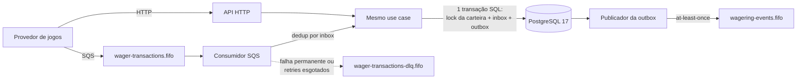

### Desenvolvedor full-stack com foco em backend e desenvolvimento com agentes de IA

**Buscando estágio ou vaga júnior em desenvolvimento — Alegrete/RS ou remoto · curso noturno**

**Português** · [English](README.en.md)

Estudante de Engenharia de Software na **UNIPAMPA — campus Alegrete/RS**, no 4º de 9 semestres (conclusão prevista para 2029/1). Gosto de tirar uma ideia do papel e ver ela funcionando de ponta a ponta: levantar os requisitos, desenhar a arquitetura, construir — e deixar o projeto organizado o suficiente para outra pessoa entrar nele no dia seguinte.

---

## Como eu trabalho

Desenvolvo com agentes de IA, sob um processo que eu mesmo construí. Cada funcionalidade nasce de uma issue com critérios de aceite, é implementada com teste antes, em commits pequenos, e chega como PR revisado por um agente revisor. Nada chega ao `main` sem a minha revisão e o meu merge.

Esse processo é o **ARK**, um kit que nasceu organizando o trabalho da equipe no SAGA. O `distributed-wagering-processor`, abaixo, foi feito com ele: 51 PRs.

**3.800+ contribuições · 130+ PRs · 360+ issues** nos últimos 12 meses · ARK: **versão 10 · 450+ commits · 12 ADRs** (nov/2026)

  

<a href="https://github.com/PPrauchner/ARK"><b>Conheça o ARK →</b></a>

---

## Experiência

**Bolsista de extensão — AI Horizon Labs / UNIPAMPA** · 2026 – atual · 20h semanais

Projeto *Educador 5.0: Capacitação de Professores para o Uso de Inteligência Artificial na Educação Básica*. Atuo presencialmente na formação continuada de professores da Educação Básica, traduzindo ferramentas de IA em uso prático de sala de aula.

---

## Projetos em destaque

### [SAGA — Sistema de Acompanhamento e Gestão Acadêmica](https://github.com/PPrauchner/SAGA-Sistema-de-Acompanhamento-e-Gestao-Academica)

Sistema de gestão para programas de pós-graduação: cadastro de discentes, plano de trabalho, validação de créditos, prorrogações e relatórios gerenciais. Projeto em equipe de 6 pessoas, com um **motor de inferência lógica construído do zero em Python** e **Programação Orientada a Aspectos** para autorização, auditoria e alertas.

> **Meu papel:** maior contribuidor do repositório (307 commits). Levantei os requisitos, organizei o trabalho da equipe e fui responsável pela maior parte das issues e da documentação. **Projetei a arquitetura do motor de inferência** — a separação entre termos, unificação, substituição, resolvedor e base de conhecimento — e defini a **camada de regras declarativas (RL01–RL05)** e a **suíte de testes** contra a qual o time implementou. **Fui responsável por boa parte da API em FastAPI** — endpoints, regras de negócio e os aspectos de autorização — e revisei metade dos PRs.

`Python` `FastAPI` `Firestore` `pytest`

### [distributed-wagering-processor — processador de transações de apostas](https://github.com/PPrauchner/distributed-wagering-processor)

Serviço que processa transações de apostas (`BET`, `WIN`, `LOSS`, `REFUND`, `ROLLBACK`) de vários provedores, por HTTP e por fila SQS, mantendo saldo e livro-razão consistentes sob concorrência e reentrega.

> **Meu papel:** projetei a arquitetura e as decisões registradas no `ARCHITECTURE.md` e em 3 ADRs — entre elas:
> - **lock pessimista por carteira**, com uma regra de ordem de locks que elimina deadlock;
> - **uma transação SQL** para saldo, livro-razão, inbox e outbox — nenhum evento sai antes do commit;
> - **idempotência em duas camadas** (inbox da fila e chave por provedor);
> - **invariantes financeiras no schema** (`CHECK`s, FKs e triggers), não só no código;
> - **duas entradas, HTTP síncrono e fila**, no mesmo caso de uso.
>
> Desafio técnico de processo seletivo, feito com o ARK: 51 PRs; 465 commits, todos meus.

`TypeScript` `Bun` `NestJS` `MikroORM` `PostgreSQL` `SQS` `Docker` `GitHub Actions`

### [ORÁCULO — auditoria de dependências Python](https://github.com/PPrauchner/Oraculo)

Ferramenta web que cruza o que um projeto **declara** depender (`pyproject.toml`, `requirements.txt`, `environment.yml`) com o que o código **realmente importa**, via análise de AST, e confronta os dois com o PyPI. Reporta *Zumbis* (declaradas e nunca usadas), *Fantasmas* (importadas e nunca declaradas) e desatualizadas, com métricas de tamanho, idade e um Índice de Saúde.

> **Meu papel:** projetei o **núcleo desacoplado da interface** e defini os **parsers registrados por decorador**, as decisões de arquitetura em ADRs, a internacionalização (pt/en) e a suíte de testes. Projeto praticamente solo: 227 dos 238 commits.

`Python` `Streamlit` `Plotly` `AST` `uv`

---

## Outros projetos

- **[Site da Maria Dinoir — Terapeuta](https://github.com/PPrauchner/Site-de-terapeuta)** · **[no ar](https://maria-dinoir-terapeuta.com/)** — site profissional para uma cliente real, do briefing à entrega: páginas institucionais, FAQ interativa e agendamento por WhatsApp. Começou em HTML/CSS puro e migrou para Astro, com o CSS reorganizado em um design system próprio. `Astro` `TypeScript` `CSS`
- **[mini-simulador-edge-cloud](https://github.com/PPrauchner/mini-simulador-edge-cloud)** — simulador de alocação de tarefas em infraestrutura Edge-Cloud, feito como desafio técnico para um processo de bolsa. `Python`
- **[LazyPR](https://github.com/PPrauchner/LazyPR-Grupo-06)** — classificação semântica de pull requests do GitHub com LLM, em pipeline funcional; fui responsável pela camada de integração com o LLM — prompts, retry e rate limit do Groq. `Python` `LLM (Groq/Llama)`

---

## Stack

Cada habilidade aponta para onde ela foi usada.

**Backend**  Python → [SAGA](https://github.com/PPrauchner/SAGA-Sistema-de-Acompanhamento-e-Gestao-Academica), [Oráculo](https://github.com/PPrauchner/Oraculo), [mini-simulador](https://github.com/PPrauchner/mini-simulador-edge-cloud) · FastAPI → [SAGA](https://github.com/PPrauchner/SAGA-Sistema-de-Acompanhamento-e-Gestao-Academica) · TypeScript/Bun, NestJS, MikroORM → [wagering](https://github.com/PPrauchner/distributed-wagering-processor) · PostgreSQL → [wagering](https://github.com/PPrauchner/distributed-wagering-processor) · filas (SQS) e outbox → [wagering](https://github.com/PPrauchner/distributed-wagering-processor) · Firestore → [SAGA](https://github.com/PPrauchner/SAGA-Sistema-de-Acompanhamento-e-Gestao-Academica)

**Front-end**  Astro · HTML/CSS → [site da terapeuta](https://github.com/PPrauchner/Site-de-terapeuta)

**Dados & IA**  LLMs (Groq/Llama) → [LazyPR](https://github.com/PPrauchner/LazyPR-Grupo-06) · análise de AST · Streamlit · Plotly → [Oráculo](https://github.com/PPrauchner/Oraculo)

**Práticas**  Docker · CI (GitHub Actions) → [wagering](https://github.com/PPrauchner/distributed-wagering-processor) · pytest → [SAGA](https://github.com/PPrauchner/SAGA-Sistema-de-Acompanhamento-e-Gestao-Academica), [LazyPR](https://github.com/PPrauchner/LazyPR-Grupo-06), [Oráculo](https://github.com/PPrauchner/Oraculo) · ADRs → [wagering](https://github.com/PPrauchner/distributed-wagering-processor), [Oráculo](https://github.com/PPrauchner/Oraculo) · agentes de IA com processo → [ARK](https://github.com/PPrauchner/ARK)

---

## Contato

Buscando estágio ou vaga júnior em desenvolvimento, **em Alegrete/RS ou remoto**. Curso noturno — disponibilidade durante o dia.

**[LinkedIn](https://www.linkedin.com/in/pietroprauchner/)** · **[E-mail](mailto:pietro.mprauchner@gmail.com)** · **[Currículo Lattes](http://lattes.cnpq.br/8153919281360932)**
